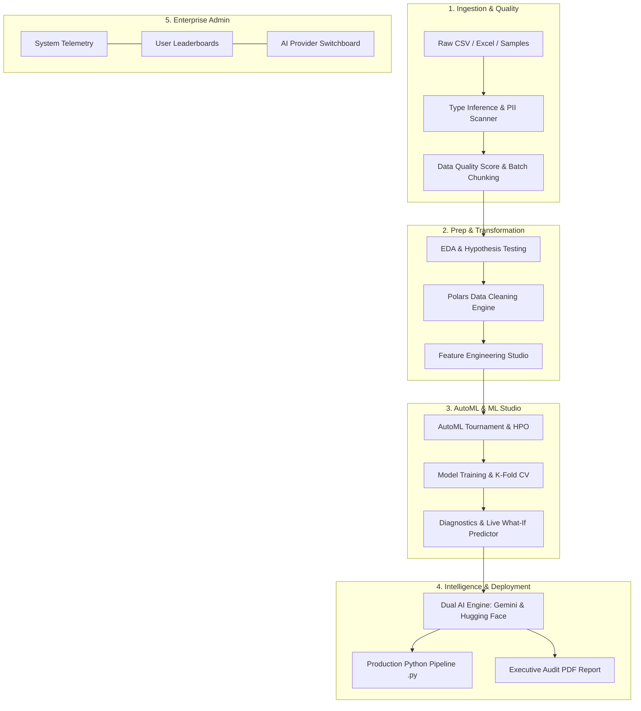

# 🚀 AutoML & EDA Studio

<div align="center">


**An Enterprise-Grade Automated Exploratory Data Analysis & Interactive Machine Learning Workbench**

[](https://react.dev/)
[](https://www.typescriptlang.org/)
[](https://vitejs.dev/)
[](https://tailwindcss.com/)
[](https://expressjs.com/)
[](https://ai.google.dev/)
[](https://huggingface.co/)
[](https://firebase.google.com/)
[](LICENSE)

[Key Features](#-key-features) • [Architecture](#-architecture--workflow) • [Supported Models](#-supported-machine-learning-models) • [Getting Started](#-getting-started) • [Deployment](#-production-deployment-guide) • [Environment Variables](#-environment-configuration) • [Admin Suite](#-admin-health--telemetry-suite) • [Project Structure](#-project-structure)

</div>

---

## 📖 Overview

**AutoML & EDA Studio** is a comprehensive, client-first tabular data science platform designed to streamline the lifecycle from raw dataset ingestion to production model deployment. It combines automated statistical profiling, PII/sensitive data detection, Polars-inspired high-speed data cleaning, mathematical feature engineering, automated benchmark tournaments, hyperparameter optimization (HPO), explainable AI (XAI), and one-click code generation for Python pipelines and executive PDF reports.

Powered by a dual AI engine supporting both **Google Gemini 2.5** and **Hugging Face Serverless Inference**, the platform provides deep context-aware dataset conclusions, column-level anomaly explanations, and interactive model interpretability.

---

## ✨ Key Features

### 1. 📥 Ingestion & Data Quality Guardian
- **Multi-Format Support**: Upload `.csv`, `.tsv`, `.xlsx`, and `.xls` files or explore built-in benchmark datasets (*Titanic Survival*, *Housing Market Rates*, *Iris Species*).
- **Automated Data Quality Scoring (0–100%)**: Evaluates missing value density, record uniqueness, outlier frequency, and column type consistency.
- **Automated Type Inference**: Instantly categorizes fields into `Numeric`, `Categorical`, `Date`, or `Text`.
- **PII & Data Sensitivity Scanner**: Proactively detects and classifies high-risk sensitive columns (Credentials/Secrets, SSN/Tax IDs, Financial cards, Emails, Phone numbers, Physical addresses, IP addresses) with confidence ratings and reasoning.
- **Large Dataset Batch Processor**: Non-blocking asynchronous chunking engine (`batchProcessor.ts`) that digests massive datasets in batches without freezing the UI, reducing LLM token consumption by up to **90%**.

---

### 2. 📊 Automated Exploratory Data Analysis (EDA)
- **Deep Distribution Profiling**: Interactive histograms with adjustable bin resolutions (5 to 50 bins), sorting by variance, skewness, outliers, or missingness.
- **Categorical Breakdown**: Top-frequency bars, unique cardinality tracking, and entropy distribution.
- **Correlation Engine**: Real-time Pearson correlation matrix with interactive bivariate scatter analysis.
- **Hypothesis Testing Suite**:
  - Independent Two-Sample **Student's T-Test**
  - **Chi-Square Test** of Independence
  - **Pearson Correlation Significance Test**
  - One-Way **ANOVA (Analysis of Variance)**
  - *Computes exact test statistics, degrees of freedom, p-values, and human-readable interpretations.*
- **Outlier Diagnostics**: Dual-method outlier detection leveraging **Interquartile Range (IQR 1.5x)** and **Z-Score (±3σ)** with extreme value inspection.

---

### 3. ⚡ Polars-Inspired High-Speed Data Cleaning
Execute rapid, reproducible client-side transformations inspired by the [Polars](https://pola.rs/) DataFrame library:
- **Missing Value Imputation**: Mean, Median, Mode, Forward Fill, Backward Fill, Custom Constant, or Row Deletion.
- **Outlier Management**: Clamping/clipping via IQR thresholds, Z-score standard deviations, or explicit boundary limits.
- **Type Casting**: Explicit casting between `Float64`, `Int64`, `String`, `Boolean`, `Date`, and `Categorical`.
- **String Sanitization**: Whitespace stripping, lowercase/uppercase conversion, and custom regex pattern matching & replacement.
- **Deduplication & Filtering**: Subset-based row deduplication and conditional threshold filters (`>=`, `<=`, `==`, `!=`, etc.).
- **Execution Audit & Code Export**: Real-time throughput reporting (rows/sec) and one-click export of an **executable Python Polars script** replicating the exact pipeline.

---

### 4. 🧮 Interactive Feature Engineering
Construct and validate new mathematical features directly inside the workbench with live distribution previews:
- **Unary Transformations**:
  - Logarithmic: Natural Log $\ln(x)$, $\log_{10}(x)$
  - Roots & Powers: Square Root $\sqrt{x}$, Square $x^2$, Power $x^p$
  - Magnitudes: Absolute Value $|x|$, Reciprocal $1/x$, Exponential $e^x$
  - Scaling: Z-Score Standardization, Min-Max Normalization
- **Binary Interactions**:
  - Arithmetic: Addition ($A + B$), Subtraction ($A - B$), Multiplication / Interactions ($A \times B$), Division / Ratios ($A / B$)
  - Extremes & Comparisons: $\min(A, B)$, $\max(A, B)$, Absolute Difference $|A - B|$
- **Instant Pipeline Mutation**: Newly engineered features are immediately available for downstream correlation analysis, AutoML training, and Python pipeline exports.

---

### 5. 🤖 Automated Machine Learning (AutoML) & Benchmarking
- **EDA-Driven Model Recommendations**: Analyzes dataset size ($N$), feature count ($P$), collinearity, skewness, and class imbalance to rank candidate algorithms.
- **Automated Tournament**: Concurrently trains multiple candidate models, compares training vs. validation metrics, flags overfitting gaps, and crowns the **Champion Model**.
- **Hyperparameter Optimization (HPO)**: Automated parameter exploration (Grid Search & Random Search) tracking trial histories and validation convergence.

---

### 6. 🧠 Machine Learning Studio & Explainable AI (XAI)
- **Model Training**: Train models client-side with configurable splits, seeds, and hyperparameters.
- **Evaluation Metrics**:
  - *Classification*: Accuracy, Precision, Recall, F1-Score, Multi-Class Confusion Matrix with per-class breakdown.
  - *Regression*: $R^2$ Score, Mean Squared Error (MSE), Root Mean Squared Error (RMSE), Mean Absolute Error (MAE), and Residual Analysis.
- **K-Fold Cross-Validation**: Stratified/K-Fold validation ($k=3, 5, 10$) with fold stability metrics.
- **Feature Importance**: Visual breakdown of Mean Decrease Impurity (MDI) or feature weights.
- **Interactive Live Predictor ("What-If" Simulator)**: Adjust input sliders and fields in real time to simulate live inference.
- **AI-Powered Model Explanations**: Generative explanation of feature weights, decision boundaries, potential biases, and production risks via Gemini or Hugging Face.

---

### 7. 📄 Production Export Ecosystem
- **Standalone Python Pipeline (`.py`)**: Fully commented, self-contained Python script using `scikit-learn`, `pandas`, `numpy`, and `joblib` for training, evaluation, and pipeline serialization.
- **Audit-Ready PDF Report (`.pdf`)**: Multi-page publication-quality PDF generated via `jspdf`, including:
  - Executive dataset summary & Data Quality scorecard
  - PII and data sensitivity findings
  - Statistical profiles, correlations, and hypothesis test results
  - Step-by-step data cleaning audit trail
  - Engineered feature formulas
  - Champion model evaluation metrics, confusion matrix / residual analysis, and top feature rankings
  - AI-generated conclusions and recommendations

---

### 8. 🛡️ Enterprise Admin Health & Telemetry Suite
- **System Monitoring**: Real-time Node.js process metrics, server uptime, CPU load average, Heap/RSS memory footprints, and request throughput.
- **Dataset Ingestion Logs**: Historical log of processed datasets, token consumption, computed API costs (USD), cleaning steps, and quality score improvements.
- **User Session Analytics**: User tier classification (*Power User*, *Active Analyst*, *Standard*), request counts, and cumulative usage.
- **Dual AI Model Switchboard**:
  - Switch dynamically between **Google Gemini** (`gemini-2.5-flash`, `gemini-2.5-pro`) and **Hugging Face Serverless Inference** (`DeepSeek-R1`, `Qwen-2.5-72B`, `Llama-3.3-70B`, `Mistral-7B`, `Phi-3.5`).
  - Integrated connection ping and latency tester.
- **Cache Management**: One-click invalidation of in-memory and server-side analysis caches.

---

## 🧬 Supported Machine Learning Models

| Algorithm | Task Type | Key Strengths & Use Cases |
| :--- | :--- | :--- |
| **Random Forest** | Classification & Regression | Ensemble of de-correlated decision trees; highly resistant to outliers and non-linear patterns. |
| **Gradient Boosted Trees (GBDT)** | Classification & Regression | Sequential residual learning; achieves state-of-the-art accuracy on complex tabular relationships. |
| **Decision Tree** | Classification & Regression | Highly interpretable, white-box model with clear split thresholds; fast training. |
| **Logistic Regression (L2 / Ridge)** | Classification | Probabilistic linear classification with L2 penalty to combat multicollinearity. |
| **Ordinary Least Squares (OLS)** | Regression | Transparent baseline linear regression model with direct coefficient interpretability. |
| **Ridge Regression (L2)** | Regression | Constrained linear model mitigating feature variance and multicollinearity. |
| **ElasticNet Regression** | Regression | Blended L1 (Lasso) and L2 (Ridge) penalty for simultaneous feature selection and grouping. |
| **K-Nearest Neighbors (KNN)** | Classification & Regression | Non-parametric instance-based learner effective on low-dimensional, local geometric structures. |
| **Gaussian Naive Bayes** | Classification | High-speed probabilistic classifier assuming feature conditional independence; ideal for baseline text or sparse data. |

---

## 🏗️ Architecture & Workflow



---

## 📁 Project Structure

```
upgraded_automl/
├── .env.example                  # Environment configuration template
├── firebase-applet-config.json   # Firebase authentication configuration
├── metadata.json                 # Studio project metadata
├── package.json                  # Project dependencies & scripts
├── server.ts                     # Express backend: Telemetry, AI endpoints, and Vite SSR
├── tsconfig.json                 # TypeScript compiler configuration
├── vite.config.ts                # Vite build configuration with Tailwind CSS plugin
├── src/
│   ├── App.tsx                   # Main application layout, session, and tab management
│   ├── main.tsx                  # React entry point
│   ├── index.css                 # Global styling and Tailwind directives
│   ├── types.ts                  # Central TypeScript interfaces and data models
│   ├── components/
│   │   ├── AdminHealthDashboard.tsx   # System health, telemetry, model switcher, and user analytics
│   │   ├── AutoMLPanel.tsx            # Model recommendation, benchmark tournament, and HPO
│   │   ├── DataUpload.tsx             # File dropzone, sample datasets, and quality scoring
│   │   ├── DistributionBackground.tsx # Visual background distribution graphics
│   │   ├── EdaTab.tsx                 # Detailed profiling, histograms, and correlation matrices
│   │   ├── FeatureEngTab.tsx          # Visual unary and binary feature engineering workspace
│   │   ├── FeatureImportancePanel.tsx # Feature importance visualizations
│   │   ├── LandingPage.tsx            # Welcoming landing experience with quick-start actions
│   │   ├── MlTab.tsx                  # Interactive model training, diagnostics, and predictions
│   │   ├── ModelExplanationModal.tsx  # Generative AI model explanations
│   │   ├── OverviewTab.tsx            # High-level dataset summary cards and preview table
│   │   ├── PolarsCleaningTab.tsx      # Polars-inspired data cleaning and Python code export
│   │   ├── SettingsModal.tsx          # User preferences and studio configurations
│   │   └── StatsTab.tsx               # Descriptive stats, hypothesis tests, and outlier results
│   ├── data/
│   │   └── samples.ts                 # Pre-loaded benchmark datasets (Titanic, Housing, Iris)
│   └── utils/
│       ├── advancedModels.ts          # GBDT, KNN, Naive Bayes, ElasticNet, and K-Fold CV
│       ├── automl.ts                  # Recommendation rules, benchmarking, and HPO engines
│       ├── batchProcessor.ts          # Asynchronous chunking engine for large datasets
│       ├── firebaseAuth.ts            # Firebase Google OAuth integration
│       ├── ml.ts                      # Core ML engines: Linear, Logistic, Trees, RF, preprocessing
│       ├── mlDiagnostics.ts           # Confusion matrix, residual analysis, Python generator
│       ├── pdf.ts                     # Multi-page executive PDF report generation
│       ├── polarsEngine.ts            # Polars data cleaning emulator & expression generator
│       ├── sensitivity.ts             # PII and sensitive data regex & heuristic scanner
│       └── stats.ts                   # Statistical distributions (t, Chi-sq, F) and test logic
```

---

## 🚀 Getting Started

### Prerequisites
- [Node.js](https://nodejs.org/) (version 18 or higher recommended)
- `npm` or `bun`

### 1. Clone the Repository
```bash
git clone -b upgrade https://github.com/yashvasudeva1/AutoML.git
cd AutoML
```

### 2. Install Dependencies
```bash
npm install
```

### 3. Configure Environment Variables
Copy the `.env.example` file to `.env`:
```bash
cp .env.example .env
```

Open `.env` and configure your credentials:
```env
# Required for Gemini AI summaries and model explanations
GEMINI_API_KEY="your-gemini-api-key"

# Application host URL
APP_URL="http://localhost:3000"

# Optional: Hugging Face User Access Token for open-source LLM inference
HF_TOKEN="your-huggingface-token"
```

> [!TIP]
> You can acquire a free Gemini API key from [Google AI Studio](https://aistudio.google.com/).
> Hugging Face tokens can be generated at [Hugging Face Settings](https://huggingface.co/settings/tokens).

### 4. Run the Development Server
```bash
npm run dev
```

The application will start on `http://localhost:3000`.

### 5. Production Build & Start
```bash
npm run build
npm run start
```

---

## 🚢 Production Deployment Guide

AutoML & EDA Studio is optimized for seamless deployment across modern container runtimes and PaaS cloud providers.

### Option A: 1-Click Deploy to Render
This repository includes a native [`render.yaml`](render.yaml) blueprint:
1. In the [Render Dashboard](https://dashboard.render.com/), click **New +** > **Blueprint**.
2. Connect your GitHub repository (`yashvasudeva1/AutoML`, branch `upgrade`).
3. Render will automatically detect `render.yaml`, configure the service, and set build/start commands.
4. Supply your secret environment variables (`GEMINI_API_KEY`, and optionally `HF_TOKEN`) in the Render dashboard.

### Option B: Container Deployment with Docker
A multi-stage, hardened production [`Dockerfile`](Dockerfile) is provided:
```bash
# 1. Build the production image
docker build -t automl-studio:latest .

# 2. Run the container
docker run -d \
  --name automl-studio \
  -p 3000:3000 \
  -e GEMINI_API_KEY="your-gemini-key" \
  -e HF_TOKEN="your-hf-token" \
  automl-studio:latest
```

### Option C: Google Cloud Run / Railway / Heroku
The included [`Procfile`](Procfile) specifies `web: npm start`:
- **Port Handling**: The server automatically binds to `0.0.0.0` and respects dynamic `$PORT` environment variables injected by cloud hosts (e.g. `PORT=8080` or `10000`).
- **Health Checks**: Point your provider's health check probe to `GET /api/health`.

### Option D: Automated CI/CD & Keep-Alive
A GitHub Actions workflow is pre-configured in [`.github/workflows/ci.yml`](.github/workflows/ci.yml):
- Runs TypeScript validation and production compilation on pushes and pull requests.
- Periodically pings free-tier cloud instances every 14 minutes to prevent server hibernation.

---

## ⚙️ Environment Configuration

| Variable | Description | Required | Default |
| :--- | :--- | :---: | :--- |
| `GEMINI_API_KEY` | Google Gemini API key for automated EDA summaries and model explanations. | **Yes** (for AI) | None |
| `APP_URL` | Application root URL used for self-referential links and OAuth redirects. | No | `http://localhost:3000` |
| `HF_TOKEN` | Hugging Face User Access Token for Serverless Inference API models. | Optional | `""` |
| `PORT` | Backend Express server port. | No | `3000` |

---

## 🛠️ Admin Health & Telemetry Suite

To access the Enterprise Admin Health Dashboard:
1. Sign in with the administrator email: **`admin@gmail.com`**.
2. Click the **Admin Health** link in the navigation header or user menu.
3. Features available in the Admin suite:
   - **System Telemetry**: Process memory (`heapUsed`, `heapTotal`, `rss`), CPU load, Node platform details.
   - **Ingestion Log**: Historical audit of datasets with latency, rows, columns, tokens, and computed costs.
   - **User Leaderboards**: Track power users, dataset counts, and token usage.
   - **AI Provider Switchboard**: Switch between Google Gemini models and Hugging Face models (*DeepSeek-R1*, *Qwen-2.5*, *Llama-3.3*, *Mistral*, *Phi*).
   - **Cache Purge**: Reset client-side and server-side analysis caches.

---

## 🔒 Security & Data Privacy

- **Client-Side Data Execution**: Data cleaning, feature engineering, and core machine learning models run client-side in the browser / Node runtime. Raw dataset records are never stored in third-party databases.
- **Token-Efficient Privacy Digests**: When requesting AI insights, only aggregated statistical digests (metadata, column distributions, correlations) are transmitted to the LLM, protecting individual row records while saving up to 90% in token overhead.
- **PII Safeguard**: Automatic identification of credentials, tax identifiers, financial accounts, and personal contact info alerts analysts prior to analysis.

---

## 📜 Available Scripts

| Command | Action |
| :--- | :--- |
| `npm run dev` | Starts the Express server with Vite in development mode via `tsx`. |
| `npm run build` | Builds the client bundle with Vite and bundles the server script with `esbuild`. |
| `npm run start` | Runs the compiled production server (`dist/server.cjs`). |
| `npm run lint` | Runs TypeScript type checking (`tsc --noEmit`). |
| `npm run clean` | Cleans up the `dist` build directory and compiled artifacts. |

---

## 🤝 Contributing

Contributions are welcome! To contribute:
1. Fork the repository.
2. Create a feature branch: `git checkout -b feature/amazing-feature`.
3. Commit your changes: `git commit -m 'Add amazing feature'`.
4. Push to the branch: `git push origin feature/amazing-feature`.
5. Open a Pull Request.

---

## 📄 License

This project is open-source and licensed under the [MIT License](LICENSE).
